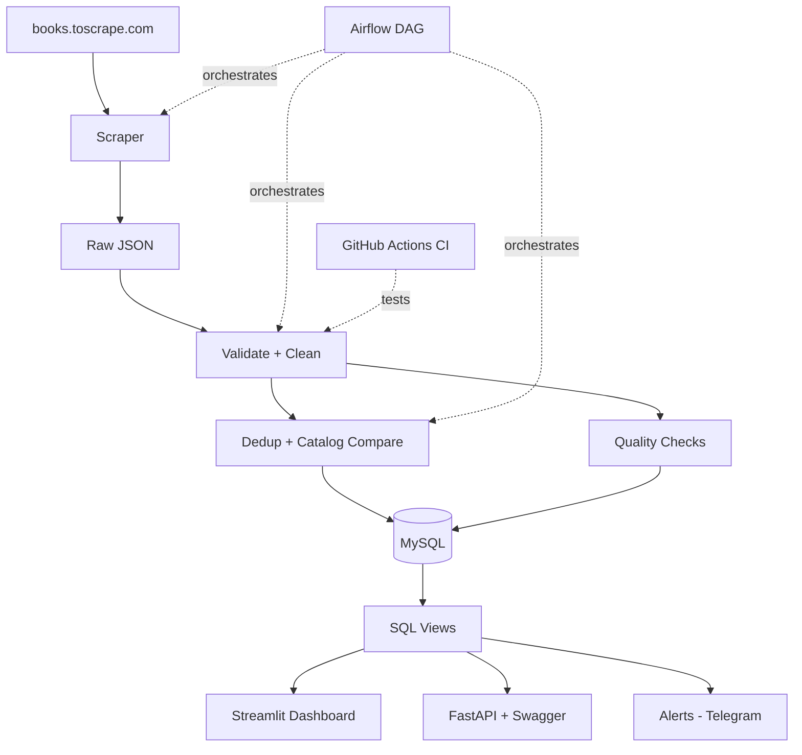

# Web-to-Warehouse Product Intelligence Pipeline

## Overview
A pipeline that scrapes product data from a website, cleans and validates it,
removes duplicates, loads it into a MySQL warehouse, runs SQL analysis
(price changes, new and removed products), and checks data quality.
Everything runs automatically every day with Apache Airflow inside Docker,
and sends a Telegram alert when a task fails or a price changes sharply.

## Architecture

## Tech Stack
Python, BeautifulSoup, Pandas, RapidFuzz, MySQL, Apache Airflow, Docker,
Streamlit, FastAPI, GitHub Actions.

## Pipeline Steps
scrape -> validate -> clean -> dedup -> load -> run_analysis -> quality_check

## How to Run
1. Clone the repo:
   `git clone https://github.com/marwa698/product-intelligence-pipeline.git`
2. Copy `.env.example` to `.env` and fill in the values (never commit `.env`).
3. Start everything: `docker compose up -d`
4. Open Airflow at http://localhost:8080 (user `airflow`, password `airflow`).
5. Enable the DAG `product_intelligence_pipeline` and click Trigger.
6. The warehouse MySQL is available on `localhost:3307`.

## Alerts & Health
- Telegram alert after the last failed retry of any task.
- Telegram alert when a product price changes by 20% or more.
- Every run is logged in the `pipeline_run_log` table.

## CI
GitHub Actions runs pytest on every Pull Request.

## Team
(Each member adds a short paragraph about their part here.)

## Future Improvements
Star schema, multiple sources, anomaly detection, live dashboard.